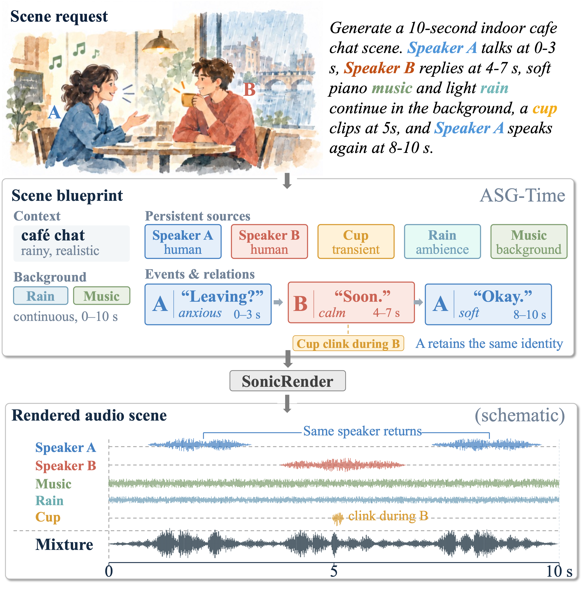

# SonicRender

### Structured and Time-Grounded Rendering of Multi-Event Audio Scene Generation

**Compose a scene. Keep its voices. Control its timing.**

SonicRender brings speech, music, sound effects, and ambience together in one coherent audio scene. **ASG-Time** specifies what happens, who produces each event, and when it occurs; **AbsTime** grounds those temporal instructions in the audio generation process.

  

Explore multi-speaker conversations, long-form scenes, Chinese dialects, English accents, and multilingual speech, alongside matched SceneMix comparisons and public benchmark examples.

This repository hosts the SonicRender audio demo. The gallery includes **46 scenes** spanning complex compositions, dialects and languages, model comparisons, and public benchmarks.

<!-- Add the live GitHub Pages demo, paper, and code links here when available. -->

## Citation

If you find SonicRender useful in your research, please consider citing our work. The BibTeX entry will be added when the paper is released.

<!-- Replace this placeholder with the final BibTeX citation. -->