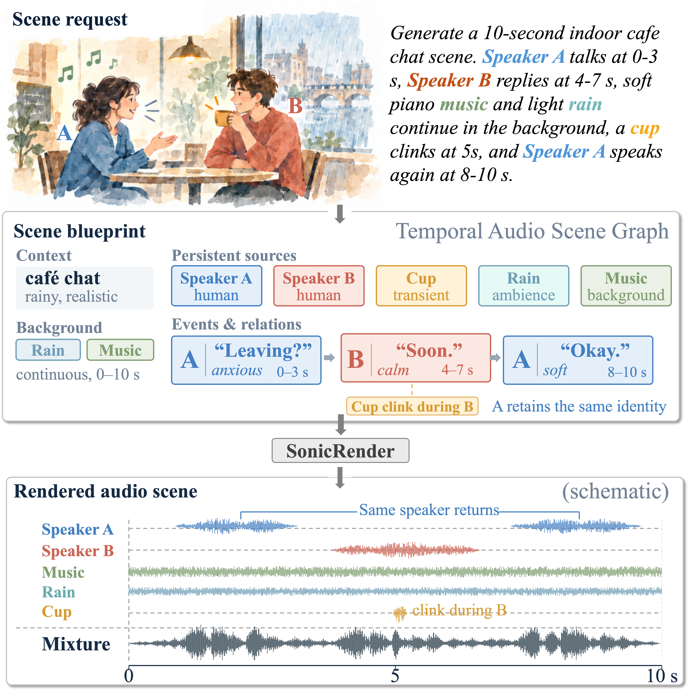

# SonicRender

### Structured and Time-Grounded Rendering of Multi-Event Audio Scene Generation

[](https://arxiv.org/abs/2611.30241) [](https://caiyunrui.github.io/SonicRender/)

**Compose a scene. Keep its voices. Control its timing.**

SonicRender brings speech, music, sound effects, and ambience together in one coherent audio scene. **ASG-Time** specifies what happens, who produces each event, and when it occurs; **AbsTime** grounds those temporal instructions in the audio generation process.

<p align="center">
  
</p>

Explore multi-speaker conversations, long-form scenes, Chinese dialects, English accents, and multilingual speech, alongside matched SceneMix comparisons and public benchmark examples.

This repository hosts the SonicRender audio demo. The gallery includes **46 scenes** spanning complex compositions, dialects and languages, model comparisons, and public benchmarks.

## Citation

If you find SonicRender useful in your research, please consider citing our work:

```bibtex
@misc{cai2026sonicrender,
  title         = {{SonicRender}: Structured and Time-Grounded Rendering of Multi-Event Audio Scene Generation},
  author        = {Yunrui Cai and Xu Li and Yan Rong and Dingdong Wang and Yucheng Zhou and Xixin Wu and Chen Zhang and Zhiyong Wu and Helen Meng},
  year          = {2026},
  eprint        = {2611.30241},
  archivePrefix = {arXiv},
  primaryClass  = {cs.SD},
  url           = {https://arxiv.org/abs/2611.30241}
}
```
